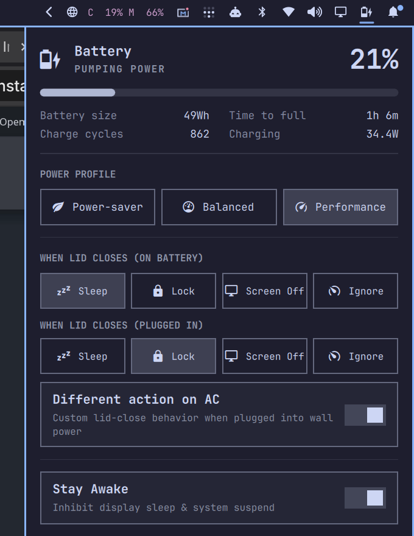

# Power Settings 󰒲

[](https://omarchy.org)
[](LICENSE)
[](https://hyprland.org)

A modern, comprehensive power management and laptop lid-control plugin for [Omarchy](https://omarchy.org/).

<p align="center">
  
</p>

---

## 🎯 What Problem It Solves

By default on Linux laptops, closing the lid either **suspends the machine** (killing your active downloads, compiles, music, or servers) or **locks without turning off the screen** (wasting battery and trapping heat against your keyboard).

**Power Settings** gives you intuitive, 1-click control right from your Omarchy status bar to decide exactly what happens when your laptop lid closes:

* **󰍹 Screen Off**: Powers down the screen panel and backlight instantly via DPMS, but **keeps your computer running 100% active** (downloads, music, and tasks continue uninterrupted).
* **󰒲 Sleep**: Locks and suspends to RAM for travel, backpack carry, and maximum battery savings.
* **󰌾 Lock**: Secures the session immediately while keeping all processes running.
* **󰾆 Ignore**: Do nothing (clamshell mode for docking stations and external monitors).

---

## ✨ Key Features

* **⚡ 1-Click Lid Actions**: Toggle between **Sleep**, **Lock**, **Screen Off**, and **Ignore** directly from the battery popup.
* **🔌 Different Action on AC**: Configure separate rules for Battery vs Plugged-In power (e.g. *Sleep on battery*, but *Screen Off on AC*).
* **☕ Stay Awake Quick Toggle**: 1-click switch to inhibit display sleep and idle timers during presentations or big downloads.
* **📊 Accurate Battery Telemetry**: Instantaneous wattage draw, remaining battery size, charge cycles, and time-to-full/empty with multi-device auto-detection (fixes `CMB0` and `BAT*` hardware differences).
* **🚀 Native Omarchy Integration**: Inherits active system theme, font styles, and corner radius tokens automatically.

---

## 🚀 Quick Install

Install and enable the plugin with a single command:

```bash
omarchy plugin add https://github.com/infinitegithub/omarchy-power-settings.git --enable --yes
```

Upon installation, Hyprland lid switches are automatically configured to use Power Settings.

---

## 🎮 Lid Close Actions Summary

| Action | Icon | System State | Screen State | Best Used For |
| :--- | :---: | :--- | :--- | :--- |
| **Sleep** | 󰒲 | Suspend-to-RAM (ACPI S3/s2idle) | Off | Traveling, in your bag, or saving battery |
| **Screen Off** | 󰍹 | **100% Active** (processes run) | **Off (DPMS)** | Downloads, music, compiling with lid closed |
| **Lock** | 󰌾 | 100% Active (processes run) | On until idle timer | Quick walk-away privacy |
| **Ignore** | 󰾆 | 100% Active | Follows monitors | Docked clamshell mode or home server |

Opening the lid at any time automatically wakes your display and restores brightness.

---

## 🗑️ Uninstallation

To restore standard Omarchy lid handling and remove the plugin:

```bash
~/.config/omarchy/plugins/power-settings/bin/remove-bindings
omarchy plugin remove power-settings
```

---

## 📄 License

Distributed under the [MIT License](LICENSE).  
Copyright © 2026 Es Sadik Sanhaji.
